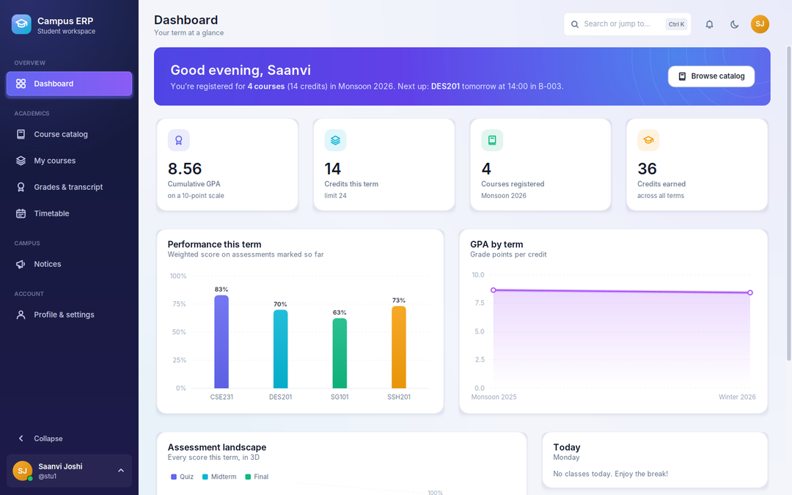
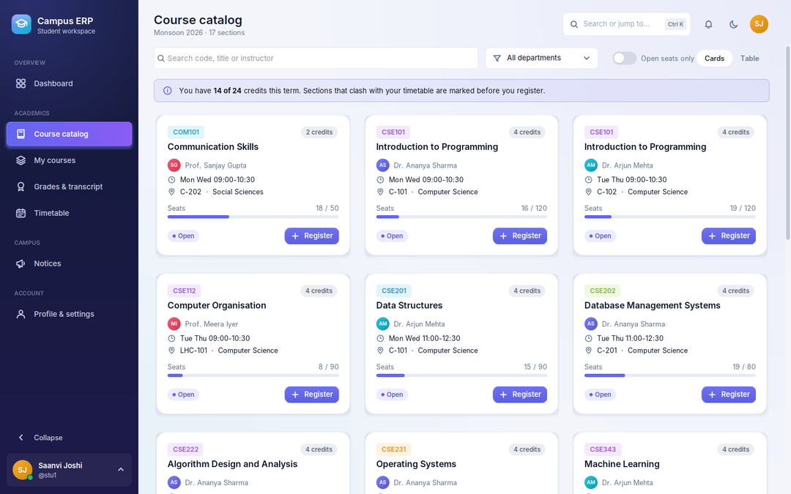
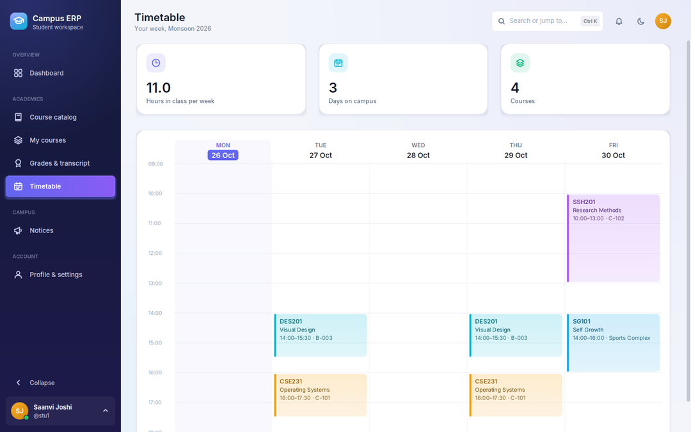
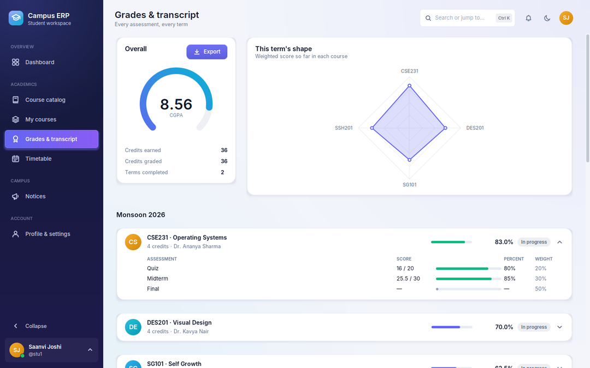
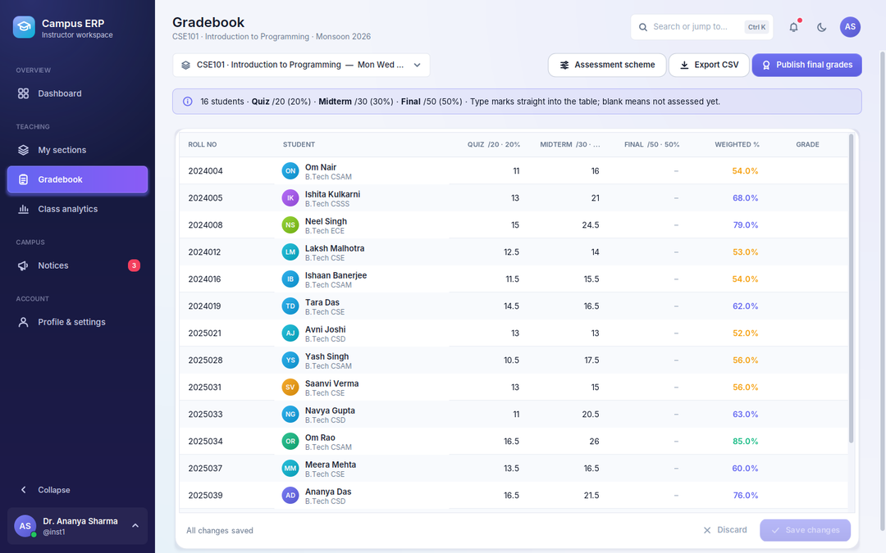
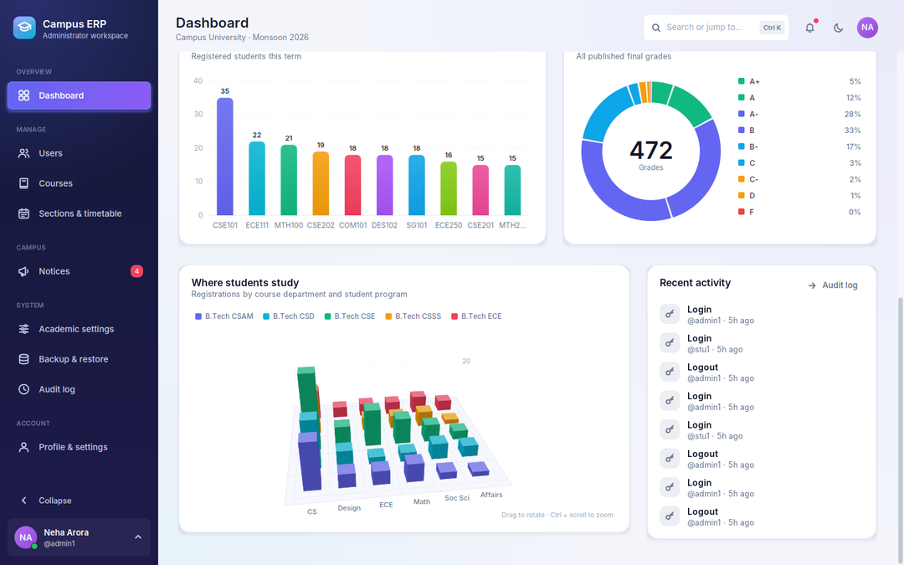
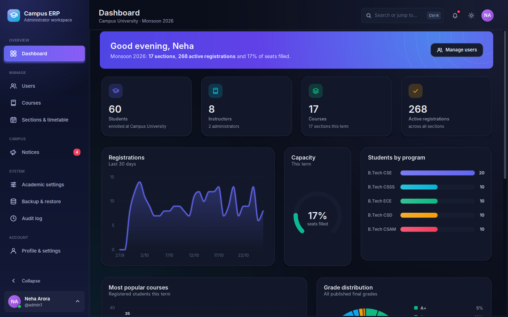
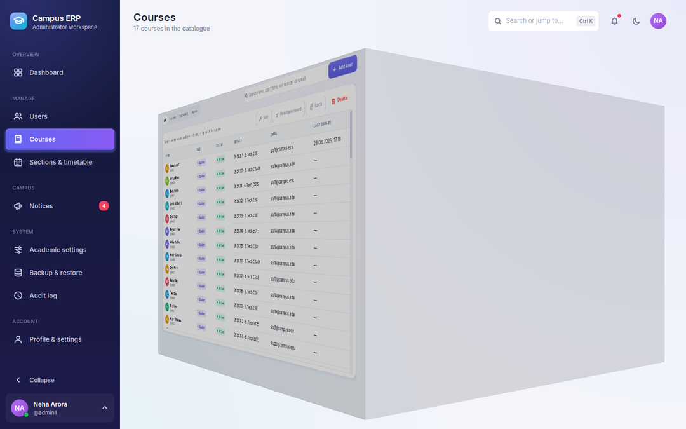

# Campus ERP 2.0

A desktop ERP for universities: registration, timetables, gradebooks, transcripts and analytics for
**students**, **instructors** and **administrators**. Java 17 + Swing, MySQL/MariaDB.


| | |
|---|---|
|  |  |
|  |  |
|  |  |
|  |  |

## Quick start

1. Install **Java 17+**, **Maven** and **MySQL 8** (or MariaDB 10.6+), and make sure the server is running.
2. Build: `mvn package` → `target/campus-erp.jar` (single runnable jar).
3. Run: `java -jar target/campus-erp.jar`
4. On first start the app asks for the database host/user/password, creates both databases itself,
   then offers to **load a demo campus** or **create the first administrator**.

Demo accounts (password `password123`): `stu1`…`stu60`, `inst1`…`inst8`, `admin1`, `registrar`.
The sign-in screen has one-click demo buttons.

Connection settings are saved to `~/.campus-erp/erp.properties`. They can also come from
`-Ddb.host=… -Ddb.port=… -Ddb.user=… -Ddb.password=…` or the `ERP_DB_HOST/PORT/USER/PASSWORD`
environment variables. Nothing is hard-coded.

## Features

**Students** — dashboard with GPA, credits and today's classes · course catalog (cards or table,
search, department filter) that flags clashes, full sections and the credit limit *before* you click ·
register / drop with deadline checks · visual weekly timetable with a live "now" marker · grades page
with per-assessment breakdowns, CGPA gauge and term GPA trend · transcript as PDF or CSV.

**Instructors** — dashboard per section · spreadsheet-style gradebook with live weighted %, invalid-mark
highlighting and unsaved-change tracking · configurable assessment scheme (any components, weights
must total 100%) · publish final grades (they recalculate automatically if marks change later) ·
analytics: distribution, grade split, per-assessment stats, radar and 3D charts · course notices · CSV export.

**Administrators** — campus dashboard (registrations trend, capacity, popular courses, grade
distribution, interactive 3D department × program chart, recent activity) · users (create/edit with
role-specific fields, lock/unlock, password reset with generator, safe delete) · courses · sections with
a day/time picker and automatic room and instructor clash checks · academic settings (term, add/drop
deadlines with calendar picker, credit limit, lockout threshold) · maintenance mode (read-only for
everyone else, live banner for signed-in users) · real backup & restore (portable `.sql`, safety copy
taken before every restore) · audit log of every change.

**Interface** — custom animation engine (60 fps, easing curves) · page transitions: slide,
fade & zoom or 3D cube · animated dropdowns, modals with frosted-glass backdrop, toasts, accordions,
count-up stats, staggered list/table entry · animated charts (bar, line, donut, radar, gauge) with
tooltips · software 3D engine: rotating crystal globe on sign-in, drag-to-rotate 3D bar charts ·
light/dark themes with cross-fade · collapsible sidebar · Ctrl+K command palette and keyboard shortcuts ·
reduce-motion option · Inter typeface bundled. All database work runs off the UI thread.

## What was fixed from v1

| v1 problem | v2 |
|---|---|
| Re-registering after a drop failed (duplicate key) | Dropped enrollment is reactivated, old marks cleared |
| Change-password stored the password in **plain text** | BCrypt everywhere + password policy |
| Login printed passwords to the console; lockout never happened | No secrets logged; account locks after N failures |
| Seat counts drifted (check-then-insert, no transaction) | Row lock + recount inside one transaction |
| Seed data started every section at 0 enrolled | Counts derived from registrations (also repaired on upgrade) |
| Drop deadline stored but never enforced; no clash/credit checks | Add/drop deadlines, timetable clash, credit limit, one section per course |
| Grade weights inconsistent (0.2 vs 20 vs 10/30/60); `ALTER TABLE` at runtime | Per-section assessment scheme table; schema migrations at startup |
| Backup/Restore only printed a message | Real SQL dump and restore |
| User + profile creation not atomic (orphan logins) | Single transaction across both schemas |
| UI froze during database calls; maintenance banner never refreshed | Background workers; status polled every 30 s |
| Hard-coded DB password; iText 5 (AGPL) dependency | External config; built-in PDF writer, no copyleft dependencies |

Existing v1 databases are upgraded in place on first start (new columns, duplicate grade rows removed,
"Monsson" typo fixed, seat counts recomputed).

## Project layout

```
src/main/java/edu/univ/erp/
  config/      connection settings
  db/          pool, schema migrations, demo seeder
  domain/      records (User, Section, Enrollment, …)
  data/        DAOs (parameterised SQL only)
  service/     business rules, validation, auth, backup, exports
  util/        time slots, grade scale, CSV, PDF writer
  ui/anim      animation clock + easing
  ui/theme     palette, fonts, light/dark
  ui/kit       buttons, cards, tables, dropdowns, modals, toasts, page stage
  ui/chart     2D charts          ui/three   3D engine, 3D chart, sign-in scene
  ui/screen    window, splash, connect, setup, sign-in
  ui/page      shell + student / instructor / admin / common pages
sql/           schema scripts (also run automatically)
```

## Tests

`mvn test` runs the unit tests. The integration suite exercises every rule above against a real
server — it **drops and recreates** both databases, so point it at a test server:

```
mvn test -Derp.it=true -Ddb.password=yourpassword
```

## Licences

Code: the project's own. Bundled Inter font: SIL Open Font License 1.1 (`src/main/resources/fonts/OFL.txt`).
Dependencies: FlatLaf (Apache 2.0), MigLayout (BSD), HikariCP (Apache 2.0), jBCrypt (ISC),
MySQL Connector/J (GPLv2 with the FOSS exception — check its terms if you redistribute a bundled jar commercially,
or swap in the MariaDB Connector/J, LGPL).
